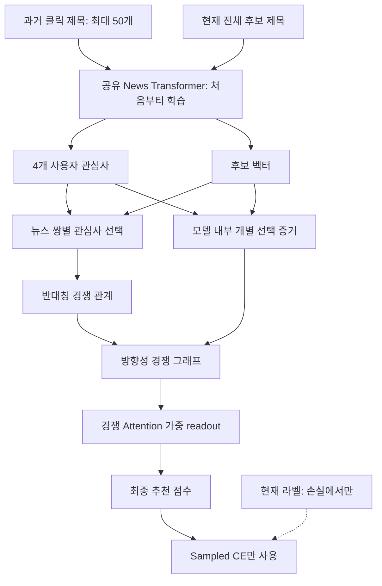

# HCCN — History-Conditioned Choice Competition Network

사용자의 과거 클릭 이력과 현재 노출 전체 후보 제목을 입력받아,
**비교하는 뉴스 쌍에 따라 사용자 관심사를 선택하고 경쟁 그래프에서 최종 추천 점수를 생성**합니다.
이름은 가칭이며, 구현·검산과 학술적 신규성·성능 입증은 구분합니다.

## 독립 모델의 범위

- HCCN 본체는 `nn.Module`이며 NRMS의 점수·동결 벡터·체크포인트를 사용하지 않습니다.
- 제목 Transformer, 사용자 관심사, 쌍별 비교와 최종 점수를 하나의 Sampled CE로 공동 학습합니다.
- 현재 클릭 여부를 입력 역할로 추정하거나 Forward에 넣지 않습니다.
- 과거 비클릭을 필수 입력으로 요구하지 않습니다.
- `nrms.py`는 A0 비교군에서만 사용합니다.
- 내부 개별 증거 $a_i$는 현재 모델의 일부입니다. 최종 출력은 $a_i$에 관계 보정을 더한 값이 아니라 그래프 readout입니다.



## 구현 수식

제목 encoder는 무작위 300차원 word embedding, 256차원 투영, 학습형 token 위치
embedding, 2개 pre-norm Transformer block(4 heads, FFN 512), attention pooling입니다.
Dropout은 0.2입니다. 학습 가능한 4개 slot query가 이력을 읽습니다.

$$z_i=E_\theta(\mathrm{title}_i),\qquad m_k=\operatorname{LN}(W_o\operatorname{Attention}(q_k,H,H)).$$

이력이 없으면 memory는 0입니다. slot이 반드시 해석 가능한 서로 다른 주제로 분리된다는 보장은 없으며,
별도 diversity/contrastive loss는 추가하지 않았습니다.

쌍 연산에서는 $x_i=Pz_i\in\mathbb R^{64}$, $c_S=\operatorname{mean}_i x_i$를 사용합니다.

$$\alpha_{ijk}=\operatorname{softmax}_k\left(Q([x_i+x_j,|x_i-x_j|])^TK(m_k)/\sqrt{64}\right),
\qquad m_{ij}=\sum_k\alpha_{ijk}V(m_k).$$

쌍 query는 대칭이므로 $m_{ij}=m_{ji}$입니다. 관계에는 stochastic dropout을 넣지 않아
같은 Forward에서 정확한 반대칭 구조를 유지합니다.

$$F_{ij}=W_2\operatorname{GELU}(W_1[x_i,x_j,x_i\odot x_j,|x_i-x_j|,m_{ij},c_S]+b),$$
$$r_{ij}=\tfrac12(F_{ij}-F_{ji}),\qquad \rho_{ij}=w^Tr_{ij}=-\rho_{ji}.$$

내부 개별 증거 $a_i$는 해당 후보가 4개 memory를 Attention으로 읽은 표현 $v_i$와
$[z_i,v_i,z_i\odot v_i,z_i-v_i]$를 작은 MLP에 넣어 만듭니다.
경쟁 가중치 네트워크는 $[x_i,x_j,m_{ij},r_{ij}]$를 입력으로 받습니다.

$$d_{ij}=a_i-a_j+\rho_{ij},\qquad
\omega_{ij}=\operatorname{softmax}_{j\ne i}G([x_i,x_j,m_{ij},r_{ij}]),$$
$$\boxed{s_i=\frac{N-1}{N}\sum_{j\ne i}\omega_{ij}d_{ij}}.$$

$N$은 패딩을 제외한 실제 후보 수입니다. singleton은 $s_i=a_i$, empty는 빈 출력을 반환합니다.
초기에 $w=0$, G의 마지막 층=0으로 설정하므로 $\rho=0$, $\omega=1/(N-1)$이고,

$$s_i=a_i-\operatorname{mean}_j a_j.$$

따라서 초기 순위·Softmax 확률은 개별 증거 모델과 일치합니다. 이 항등식은 값과 gradient로
검산합니다. 초기 안정성 장치이며 학습 후 성능 향상을 보장하지 않습니다.

## 손실과 공정 비교 단위

Forward는 **현재 노출 전체 후보**를 사용합니다. 손실만 클릭 1개와 같은 노출의
비클릭 4개를 고릅니다. 비클릭이 부족할 때만 복원 추출합니다.

$$\mathcal L=-\log\frac{\exp(s_p)}{\exp(s_p)+\sum_{n\in N_4}\exp(s_n)}.$$

여러 클릭이 있으면 클릭별로 학습 사례를 만들며 **클릭 사례 기준으로 평균**합니다.
다른 클릭을 negative로 쓰지 않습니다. BCE, Pair, Role, Edge 보조 손실은 없습니다.
현재 결과는 관측 클릭의 상대적 순위이며, 비클릭이 실제 혐오라는 인과 해석은 하지 않습니다.

## A0–A5 비교

| ID | 코드명 | 내용 | 확인 범위 |
|---|---|---|---|
| A0 | `nrms_ce` | 무작위 초기화 NRMS + CE | 기존 구조 기준선 |
| A1 | `individual` | 새 제목 encoder + 다중 관심사 + 개별 증거 | 새 인코더/사용자 표현의 결합 효과 |
| A2 | `self_attention` | A1 + 일반 후보 Self-Attention | 일반 집합 상호작용 |
| A3 | `common_interest` | 경쟁 그래프, 모든 쌍에 slot 평균 사용 | 공통 사용자 정보의 관계 모델 |
| A4 | `hccn_full` | 뉴스 쌍마다 사용자 관심사를 선택 | **A3 대비 핵심 비교** |
| A5 | `no_rho` | A4에서 scalar rho만 0 | 직접적인 쌍 증거 항의 기여 |

**A5에서도 경쟁 가중치 G는 m 및 r을 받습니다.** 따라서 A5는 모든 비분리적 관계 효과를
제거한 모델이 아닙니다. A4−A5만으로 모든 관계의 필요성이 입증됐다고 주장하지 않습니다.
A0→A1은 뉴스 encoder도 바뀌므로 다중 관심사만의 효과가 아닙니다.

같은 seed의 A1–A5는 동일 전체 파라미터 초기값, 클릭 사례 순서·negative 샘플을 사용합니다.
단, 미사용 모듈의 학습 경로가 달라 활성 파라미터/FLOPs까지 동일하지는 않습니다.
A0는 다른 아키텍처이며, 현재 프로토콜에서는 전체 후보를 같은 microbatch로 인코딩합니다.
과거 NRMS의 sampled-only Forward와 계산·dropout 실행 순서가 다를 수 있으므로 새 A0와 직접 비교합니다.

## 실행

저장소 루트에서 실행합니다. 공통 의존성은 루트 `requirements.txt`입니다.

```bash
# 이미 준비된 데이터는 재생성하지 않음
python prepare.py --dataset small --train-dir data/raw/small/train --dev-dir data/raw/small/dev
python -m unittest discover -s tests -p test_hccn.py -v
python -m hccn.prepare_experiment
python -u -m hccn.run_queue
```

- `HCCN_PREPARED_DIR`: 전처리된 small 디렉터리. 기본값 `NEWS_DATA_ROOT/small`.
- `HCCN_OUTPUT_ROOT`: 실행 결과 위치. 기본값 `hccn/`.
- 기본 설정: Adam 0.001, batch 64 클릭 사례, microbatch 최대 2, clip 4, BF16.
- 3 seeds: 26111701, 26111702, 26111703. **6조건 × 3seed = 18회 학습**, 각 5에폭.
- 각 seed에서 Full→Common→Individual→Self-Attention→No-rho→NRMS 순서로 실행합니다.
- 시작 전에 소스·입력·모든 seed의 샘플 스트림과 설정을 동결합니다.
- 같은 seed의 6조건 학습 후 VALID NDCG@10 최고를 선택(동률은 이른 epoch), 모두 동결한 뒤 TEST 평가합니다.
- 기존 결과가 있는 실행 폴더는 임의 재실행/덮어쓰지 않습니다. 중단 복구는 별도 검토가 필요합니다.

Small의 공식 TRAIN을 기존 시간순 FIT/VALID로 나누고 공식 DEV 전체를 연구용 TEST로 사용합니다.
TEST를 새 구조·학습률 선택에 쓰지 않습니다. DEV가 반복 사용되었다면 독립 최종 TEST가 아닙니다.
이 큐는 MIND-large를 자동으로 시작하지 않습니다. Large 또는 별도 미사용 평가 구간의 확인은 후속 계획입니다.

## 검산 및 기록

`prepare_experiment`는 현재 TEST 정답을 열지 않고 이력 96개를 재구성해 감사하고,
전체 3seed × 5epoch의 클릭 사례/negative 순서를 해시로 동결합니다.
실제 FIT 최대 후보 노출과 대표 배치에서 GPU optimizer step 및 cache parity를 검증하고 임시 가중치는 폐기합니다.
이 smoke는 18회의 독립 학습 결과가 아닙니다.

CPU 검사는 중립 초기화, gradient 항등식, 쌍별 관심사 대칭성, 관계 반대칭성,
분해한 MLP와 원식의 값/gradient 일치, 순열·패딩·chunk·빈 입력 안전성,
CE만으로 전체 핵심 모듈의 gradient 전달, cache 및 loss 샘플링을 확인합니다.

- `runs/<seed>/<mode>/EPOCHS.json`: 학습 손실·VALID·시간·peak memory
- `frozen/<seed>.json`: TEST 전에 동결한 선택 체크포인트
- `runs/<seed>/<mode>/research_TEST/`: AUC/MRR/NDCG@5/10, 전체 점수, 노출별 지표
- `VALID_GRAPH_DIAGNOSTICS.json`: 고정 VALID 표본에서 관계의 스칼라 점수 차이 투영 잔차,
  공통 관심사로 대체, 뉴스 쌍과 관심사 연결을 순열로 교란한 frozen-weight 결과
- `RESULT_KO.html`, `RESULT.json`: 완료된 TEST 결과 및 seed 평균/표준편차

Frozen-weight 진단은 재학습 ablation과 다릅니다. rho의 비분리적 에너지가 크더라도
잡음일 수 있으므로 추천 성능 개선을 별도로 확인해야 합니다.
쌍 연산은 여전히 O(N²K)이며, 실행 시간·메모리도 성능과 함께 보고해야 합니다.

## 선행연구와 현재 주장 범위

- [MINER, ACL Findings 2022](https://aclanthology.org/2022.findings-acl.29/): 뉴스 추천의 다중 관심사 matching.
- [SetRank, SIGIR 2020](https://arxiv.org/abs/1912.05891): 후보 집합의 문맥과 순열 대응 Attention ranking.
- [DeepHalo, arXiv 2026](https://arxiv.org/abs/2601.04616): 선택 집합의 쌍별·고차 문맥 효과 모델링.

다중 관심사, 후보 관계, 집합 문맥 각각은 이미 연구되어 있습니다. 현재의 차별화 후보는
**뉴스 쌍에 조건화한 관심사 선택을 경쟁 그래프 readout에 연결한 구체적 메커니즘**입니다.
이는 가설이며 최초성 또는 기존 방법 대비 우위가 확정된 것은 아닙니다.
논문 기여 판단은 A3↔A4 및 강한 대조군, 3seed, 미사용 조건의 후속 확인을 근거로 해야 합니다.
