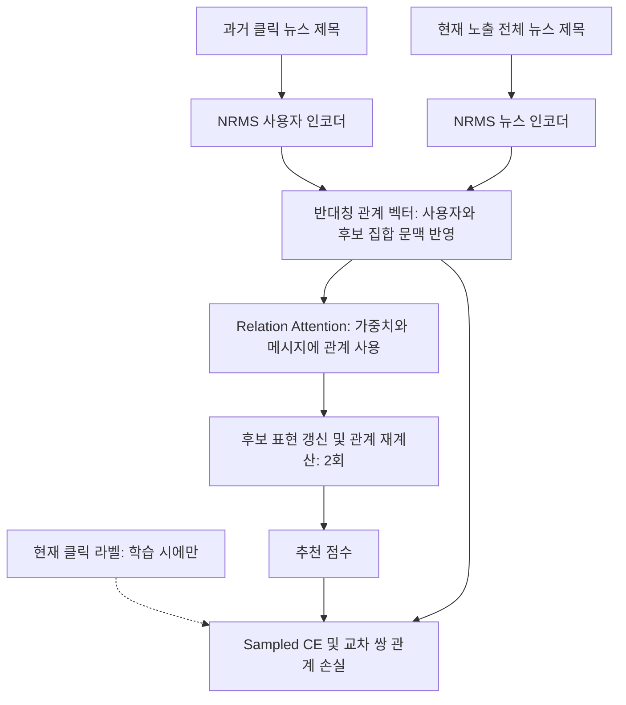

# Role-Free Neural Relation Learning

현재 노출 후보들을 클릭·비클릭 역할로 미리 나누지 않고, 관계 벡터로 후보 표현을
갱신하는 뉴스 추천 연구 코드입니다. **현재 클릭 라벨은 모델 입력이 아니라 손실의 감독 신호**입니다.
모든 인코더는 처음부터 함께 학습하며 동결된 기존 모델의 가중치를 요구하지 않습니다.

## 구조



뉴스·사용자 인코더는 기존 NRMS와 같은 구현입니다. 입력 제목 최대 32 token,
이력 최대 50개, 인코더 256차원, 관계 64차원, 4 heads, 2 rounds를 사용합니다.
완전히 새로운 기본 인코더를 발명한 것으로 설명하지 않습니다.

## 수학적 정의

뉴스 투영을 $x_i$, 사용자 투영을 $u$, 초기 상태를 $h_i^0=\operatorname{LN}(x_i+u)$,
현재 후보 상태의 평균을 $c$라 합니다. 패딩은 평균과 관계 계산에서 제외합니다.

$$
\phi(i,j)=[h_i,h_j,h_i\odot h_j,|h_i-h_j|,u,c],\qquad
F(\phi)=W_2\operatorname{GELU}(W_1\phi+b_1)
$$

$$
r_{ij}=\tfrac12\{F(\phi(i,j))-F(\phi(j,i))\},\qquad
\rho_{ij}=w^T r_{ij},\qquad \rho_{ji}=-\rho_{ij}.
$$

관계 벡터는 각 head에서 다음 두 경로에 모두 사용합니다.

$$
\alpha_{ij}=\operatorname{softmax}_j(q_i^Tk_j/\sqrt{d_h}+b_h(r_{ij})),
\qquad m_i=W_o\operatorname{Concat}_h\left[\sum_j\alpha_{ij}(v_j+V_h(r_{ij}))\right].
$$

패딩·자기 이웃은 제외하고 logit/value가 0인 null 이웃을 둡니다.
유효 이웃이 없으면 상태를 그대로 유지합니다. 실제 이웃에 할당한 Attention 질량의
head 평균을 $\gamma_i$라 할 때,

$$
h_i^+=\operatorname{LN}\{h_i+\gamma_i\tanh(\operatorname{MLP}[h_i,m_i,h_i\odot m_i])\}.
$$

공유 가중치로 관계 계산과 상태 갱신을 두 번 반복합니다. 최종 상태 변화
$\Delta h_i=h_i^2-h_i^0$가 없을 때 점수 변경도 0이 되도록 아래 출력을 사용합니다.

$$
s_i=s_{i,\mathrm{NRMS}}+\operatorname{softplus}(\beta)
\{g([x_i,u,\Delta h_i,\Delta h_i\odot x_i])-g([x_i,u,0,0])\}.
$$

초기 gain은 0.1이고 $g$의 마지막 층은 0으로 초기화합니다. 이는 안정적 초기화를
위한 장치이며, 이 장치 자체를 신규 기여로 주장하지 않습니다.

## 학습 손실과 라벨 범위

$$
\mathcal L_{\mathrm{rel}}=\frac{1}{|P||N|}
\sum_{p\in P,n\in N}\operatorname{softplus}(-\rho_{pn}),\qquad
\mathcal L=\mathcal L_{\mathrm{sampled\ CE}}+0.2\mathcal L_{\mathrm{rel}}.
$$

- Forward는 전체 후보를 사용합니다. 현재 정답이나 추정 Positive/Negative 역할은 입력하지 않습니다.
- CE는 클릭 하나와 같은 노출의 비클릭 4개를 사용합니다. 부족할 때만 복원 추출합니다.
- 하나의 노출에 클릭이 여러 개면 모든 클릭의 CE를 평균하고 다시 노출별 평균을 취합니다.
- 관계 손실은 해당 노출의 **전체 P×N**에 적용합니다. 같은 라벨 쌍에는 방향 감독을 하지 않습니다.
- 비클릭을 사용자의 실제 혐오 또는 인과적 부정 선호라고 해석하지 않습니다.

## 통제 비교

| 코드명 | 후보 갱신 | 손실 | 자동 큐 |
|---|---|---|---|
| `rf_full` | 관계 Attention | CE + 0.2 관계 감독 | 포함 |
| `rf_no_relation_loss` | 관계 Attention | CE | 포함 |
| `plain_attention_pair` | 일반 후보 Attention | CE + 0.2 점수 Pair | 포함 |
| `nrms_ce_pair` | 없음 | CE + 0.2 점수 Pair | 포함 |
| `rf_aux_only` | 없음, 관계 감독만 | CE + 0.2 관계 감독 | 구현·단위 검사만 |
| `nrms_ce` | 없음 | CE | 구현·단위 검사만 |

점수 Pair는 $\operatorname{softplus}(-(s_p-s_n))$의 전체 교차 쌍 평균입니다.
네 자동 조건은 같은 seed, 같은 공통 인코더 초기값, 같은 FIT 노출 및 CE 비클릭 샘플,
같은 optimizer·학습 예산을 사용합니다. 전체 파라미터 트리는 동일하게 초기화하지만
baseline의 미사용 경로는 학습되지 않습니다. **활성 파라미터 수나 FLOPs가 같은 비교는 아닙니다.**

기존 `sampled_ce.py`는 클릭 사례 단위, 이번 코드는 노출 단위로 손실을 평균합니다.
따라서 과거 실행과의 차이는 관계 구조만의 효과로 해석할 수 없습니다.
단순 보조 학습 효과와 관계 메시지 사용 효과를 완전히 구분하려면 `rf_aux_only`의
후속 재학습도 필요합니다. 이번 네 조건만으로 모든 메커니즘이 입증되지는 않습니다.

## 실행

모든 명령은 저장소 루트에서 실행합니다. Python/CUDA 환경은 루트 README와 같습니다.
기본 출력은 `role_free/` 아래이며 기존 RCRIN 출력과 겹치지 않습니다.

```bash
# 1. 이미 준비됐다면 반복 실행하지 않음
python prepare.py --dataset small --train-dir data/raw/small/train --dev-dir data/raw/small/dev

# 2. CPU 구조·gradient 검사
python -m unittest discover -s tests -p test_role_free.py -v

# 3. 시간 인과성 감사, 동일 샘플 스트림, 실제 GPU step 검산 후 프로토콜 동결
python -m role_free.prepare_experiment

# 4. 4조건 학습, VALID 선택 동결, TEST, 결과표 생성
python -u -m role_free.run_queue
```

전처리는 루트의 `NEWS_DATA_ROOT` 설정을 따릅니다. 이 비교 큐는 **small만** 지원합니다.
`prepare_experiment`는 TEST 정답을 열지 않으며, smoke에 사용한 임시 가중치는 폐기합니다.
기존 준비 데이터·실행·동결 파일이 있으면 임의 덮어쓰기하지 않고 종료합니다.
중단된 학습을 자동으로 처음부터 다시 실행하는 기능은 없습니다.

고정 조건은 seed 26111701, Adam LR 0.001, 배치 32 노출, clip 4, BF16,
조건당 **최대 5에폭(현재 조기 종료 없음)**입니다. 네 조건의 모든 학습이 끝나면
VALID NDCG@10 최고 에폭을 동결하며 동률이면 앞선 에폭을 사용합니다.
그 뒤 공식 DEV 전체를 연구용 TEST로 평가합니다. 공식 challenge TEST가 아닙니다.
이미 관찰한 공식 DEV라면 미사용 독립 TEST라고 부를 수 없습니다.

GPU가 이미 바쁘다면 사용자가 실행 시점을 정해야 합니다. 공개 큐는 개인 PC의 특정 PID를
기다리는 로컬 스케줄러에 의존하지 않고 명령 실행 즉시 시작합니다.
CPU 검사만 하려면 2번까지만 실행하면 됩니다.

## 기록과 검산

- `FROZEN_PROTOCOL.json`: 코드·데이터 해시, 초기값 및 5에폭 샘플 해시
- `runs/<mode>/EPOCHS.json`: 손실, VALID, 시간, peak CUDA memory
- `ALL_MODELS_FROZEN.json`: 모든 조건의 선택 체크포인트
- `runs/<mode>/research_TEST/`: 선택된 모델의 전체 TEST 점수와 노출별 지표
- `runs/<mode>/VALID_RELATION_DIAGNOSTICS.json`: 고정 VALID 표본의 관계 진단
- `RESULT_KO.html`, `RESULT.json`: TEST 완료 조건만 수치로 표시하는 결과표

관계가 스칼라 점수 차이로 환원되는지 아래 최소제곱 투영 잔차도 측정합니다.

$$
v_i=\frac1N\sum_j\rho_{ij},\qquad
R=\frac{\sum_{ij}(\rho_{ij}-(v_i-v_j))^2}{\sum_{ij}\rho_{ij}^2}.
$$

분모가 거의 0이면 해석하지 않습니다. R>0은 잡음으로도 발생하므로, 그 자체를
유용한 관계나 신규성의 증거로 주장하지 않습니다.

단위 검사는 쌍 MLP 분해 전후 값·gradient 일치, 반대칭성, 순열 대응성, 패딩 무관성,
singleton/empty, 현재 라벨 없는 Forward, cache parity, 교차 쌍 감독과 gradient 경로를 포함합니다.
핵심 `model.py`는 별도 실험에서 검산한 코드와 byte 단위로 동일합니다.
공개본은 경로·패키지 import·데이터 loader·실행 명령을 저장소에 맞춘 배포본이며
원래 개인 작업 폴더를 요구하지 않습니다. 전체 학습의 bitwise 재현은 보장하지 않습니다.

## 신규성의 경계

[SetRank (SIGIR 2020)](https://arxiv.org/abs/1912.05891)은 후보 집합 상호작용과
순열에 대응하는 Attention ranking을 다룹니다.
[Shaw et al. (NAACL 2018)](https://aclanthology.org/N18-2074/)은 relation-aware Attention을,
[EGT (KDD 2022)](https://arxiv.org/abs/2108.03348)은 edge channel과 전역 Attention을 다룹니다.
[DirectRanker (2019)](https://arxiv.org/abs/1909.02768)도 반대칭 pairwise ranking을 분석합니다.

따라서 관계 벡터·반대칭성·Attention 각각은 신규성의 근거가 아닙니다.
검증할 가설은 **현재 클릭을 입력하지 않는 후보 집합에서 클릭–비클릭 관계를 직접 감독하고,
그 표현을 후보 갱신에 사용할 때 일반 Attention 및 점수 Pair보다 도움이 되는가**입니다.
비선형 F도 단순 점수 차이를 학습할 수 있으며, 두 번의 메시지 전달만으로
독창적인 고차 집합 관계가 입증되지 않습니다. 성능 우위와 학술적 신규성은 아직 미확정입니다.
